# Redesign cooolinho.de – Designkonzept

Stand: 16.11.2026 · Status: **Entwurf C – „Bento“ ausgewählt und umgesetzt** (`index.html`, `src/style.scss`, `src/main.js`).

- [1. Ausgangslage](#1-ausgangslage)
- [2. Anforderungen](#2-anforderungen)
- [3. Die drei Entwürfe](#3-die-drei-entwürfe)
- [4. Vergleich](#4-vergleich)
- [5. Empfehlung](#5-empfehlung)
- [6. Nächste Schritte](#6-nächste-schritte)

**Mockups ansehen:** Die Entwürfe sind klickbare HTML-Dateien mit echten Inhalten, Hell/Dunkel-Umschalter und Animationen. Repo auschecken und die Datei direkt im Browser öffnen (kein Build nötig):

| Entwurf | Datei |
|---|---|
| A – Shell | [`mockups/a-shell/index.html`](mockups/a-shell/index.html) |
| B – Editorial | [`mockups/b-editorial/index.html`](mockups/b-editorial/index.html) |
| C – Bento | [`mockups/c-bento/index.html`](mockups/c-bento/index.html) |

Mit `?theme=light` bzw. `?theme=dark` an der Adresse lässt sich der Farbmodus erzwingen. Die Screenshots unten zeigen einen Standzustand – die Bewegung sieht man nur im Mockup selbst.

---

## 1. Ausgangslage

Die heutige Seite ist ein Onepager, der vollständig als Terminalfenster gestaltet ist.

| Desktop (Start) | Mobil (Start) |
|---|---|
| 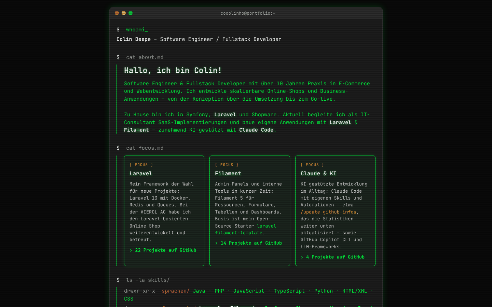 | 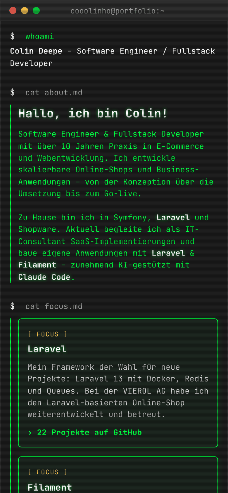 |

Ganze Seite: [Desktop](ist/ist-desktop.png) · [Mobil](ist/ist-mobil.png)

**Was gut funktioniert**

- Klare, eigenständige Idee: Jeder Bereich ist ein Befehl (`whoami`, `cat about.md`, `git log --career`).
- Inhalte sind vollständig und aktuell, die GitHub-Statistiken werden automatisch gepflegt.
- Technisch schlank (Vite, SCSS, kein Framework), SEO und strukturierte Daten sind sauber.

**Was das Redesign lösen soll**

- **Lesbarkeit:** Neon-Grün in Monospace auf Schwarz, dazu Scanlines über der ganzen Seite – lange Texte (Über mich, Werdegang) sind anstrengend zu lesen.
- **Platz:** Alles steckt in einer 800 px breiten Spalte; auf großen Bildschirmen bleibt der Großteil leer, die Seite wird sehr lang.
- **Kein Einstieg:** Der Start zeigt nur eine Zeile Name + Rolle. Es gibt keine Navigation, kein Foto, keinen klaren Weg zum Kontakt.
- **Nur dunkel:** kein heller Modus.
- **Keine Projekte:** Arbeiten tauchen nur indirekt in Fließtext und GitHub-Liste auf.
- **Ein Ton für alle:** Der Terminal-Look spricht Entwickler an, Recruiter und Kunden eher weniger.

---

## 2. Anforderungen

Ergebnis der acht Abstimmungsfragen:

| Thema | Entscheidung |
|---|---|
| Zielgruppe | Mischung: Recruiter, Kunden, Dev-Community |
| Terminal-Look | pro Entwurf unterschiedlich gelöst |
| Farbmodus | Hell + Dunkel (Systemeinstellung + Umschalter) |
| Farbwelt | freie Hand, eigene Palette je Entwurf |
| Porträt | ja, dezent (`public/foto.png`) |
| Inhalt | Onepager + neuer Projekte-Bereich |
| Animation | ausgeprägt, darf verspielt sein |
| Bandbreite | drei klar verschiedene Richtungen |

Für alle drei Entwürfe gilt außerdem: gleiche Inhalte wie heute, responsiv ab 390 px, Animationen werden bei „Bewegung reduzieren“ im Betriebssystem abgeschaltet.

**Neuer Projekte-Bereich** (in allen Entwürfen identisch befüllt): laravel-filament-template, discord-bot-v2, laravel-filament-foerdertafel, laravel-my-media-library (Open Source), vierol-shop.de (beruflich), tsv-grossenkneten.de (Ehrenamt).

---

## 3. Die drei Entwürfe

### Entwurf A – „Shell“

**Idee:** Das Terminal bleibt das Leitmotiv, wird aber vom CRT-Nachbau zur modernen, bedienbaren Shell. Die Seite nutzt die volle Breite und lässt sich tatsächlich per Befehl steuern.

| Hell | Dunkel |
|---|---|
| 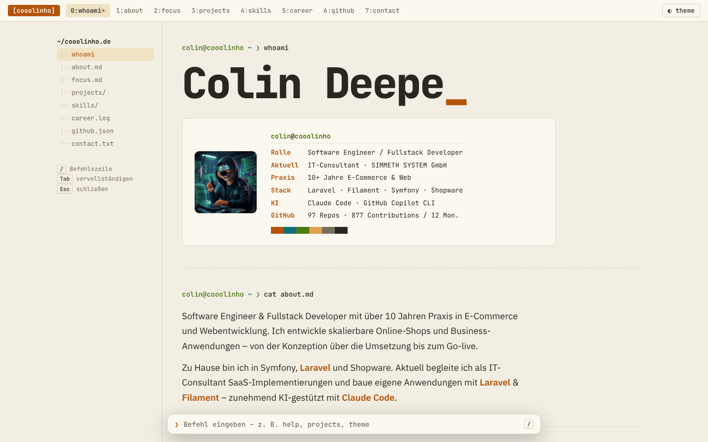 | 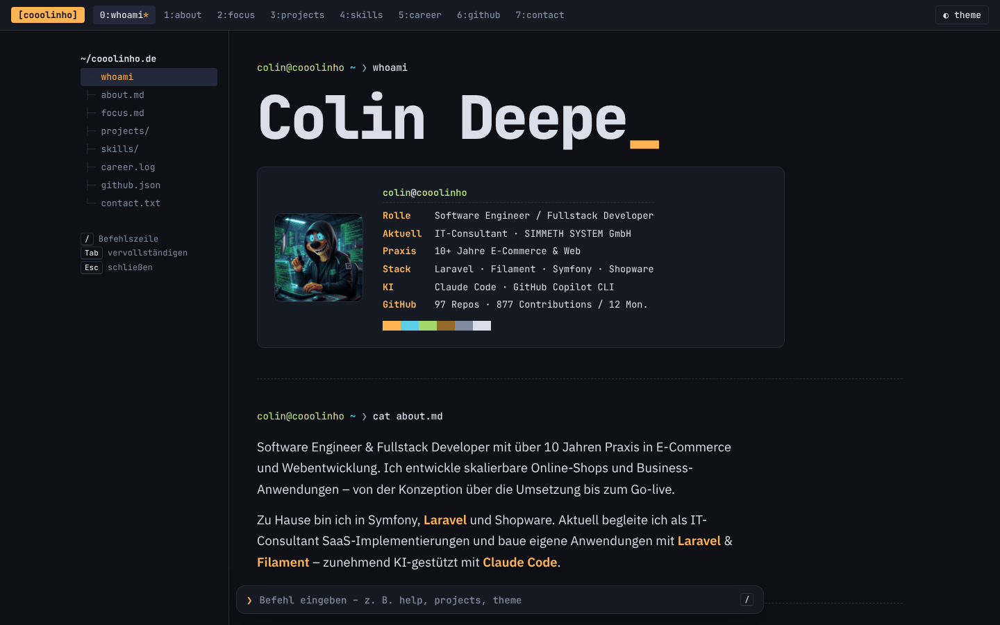 |

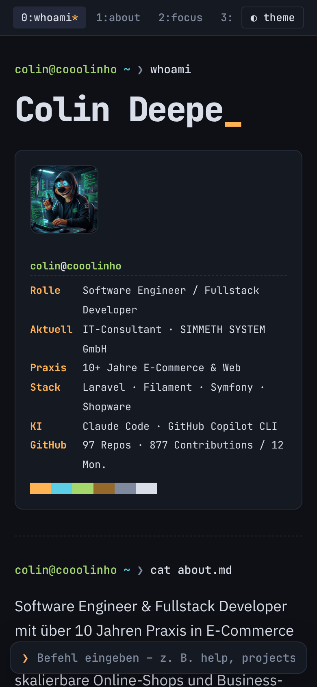

Ganze Seite: [Desktop hell](screenshots/a-shell-desktop-hell.png) · [Desktop dunkel](screenshots/a-shell-desktop-dunkel.png) · [Mobil](screenshots/a-shell-mobil.png)

| | |
|---|---|
| **Terminal** | bleibt Leitmotiv: Statusleiste mit Tabs (wie tmux), Dateibaum als Navigation, Prompt-Zeile über jedem Bereich |
| **Aufbau** | Start als „neofetch“-Karte mit Avatar und Eckdaten → Über mich → Fokus → Projekte als Datei-Karten → Skills als Verzeichnisliste → Werdegang als Git-Graph (Freiberuflichkeit als eigener Branch) → GitHub → Kontakt |
| **Farben hell** | Papier `#f3eee3`, Fläche `#fbf8f0`, Text `#2a2620`, Akzent Rostorange `#b4530a`, Zweitfarbe Petrol `#0f6f86` |
| **Farben dunkel** | Hintergrund `#0e1016`, Fläche `#151922`, Text `#d9dee8`, Akzent Bernstein `#ffb454`, Zweitfarbe Cyan `#5ccfe6` |
| **Schriften** | JetBrains Mono (Überschriften, Bedienelemente) + IBM Plex Sans (Fließtext, für bessere Lesbarkeit) |
| **Bewegung** | Befehle werden beim Scrollen getippt, Ausgabe erscheint zeilenweise; Heatmap füllt sich spaltenweise; Sprachbalken wachsen; Zähler laufen hoch |
| **Interaktion** | Befehlszeile am unteren Rand: `help`, `projects`, `career`, `theme`, `mail` … mit Tab-Vervollständigung, Taste `/` setzt den Fokus |

**Stärken:** höchster Wiedererkennungswert, knüpft an die heutige Seite an, die Befehlszeile ist ein echter Hingucker für Entwickler. Fließtext ist dank Sans-Schrift und ruhigerer Palette deutlich lesbarer als heute.

**Schwächen:** bleibt eine Nischen-Ästhetik – Recruiter und Kunden ohne Technikbezug müssen sich auf die Metapher einlassen. Der helle Modus ist ungewohnter als der dunkle.

---

### Entwurf B – „Editorial“

**Idee:** Der Terminal-Look wird komplett abgelöst. Die Seite liest sich wie ein gut gesetztes Magazin-Porträt: große Serifen, viel Weißraum, nummerierte Kapitel.

| Hell | Dunkel |
|---|---|
| 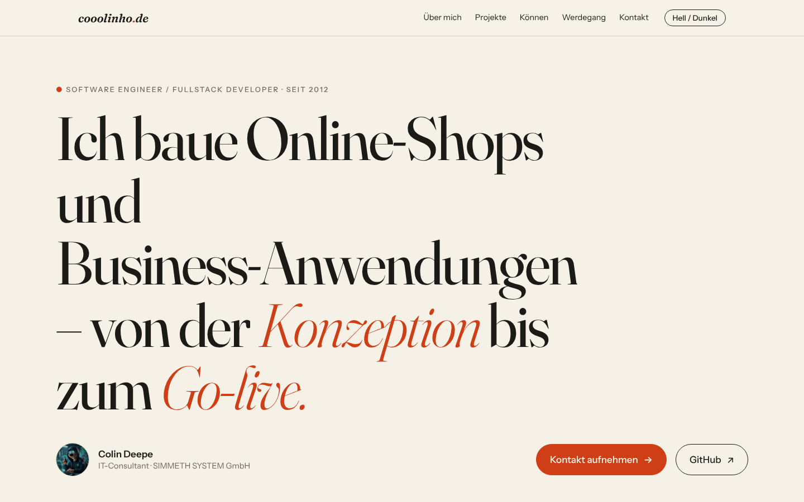 | 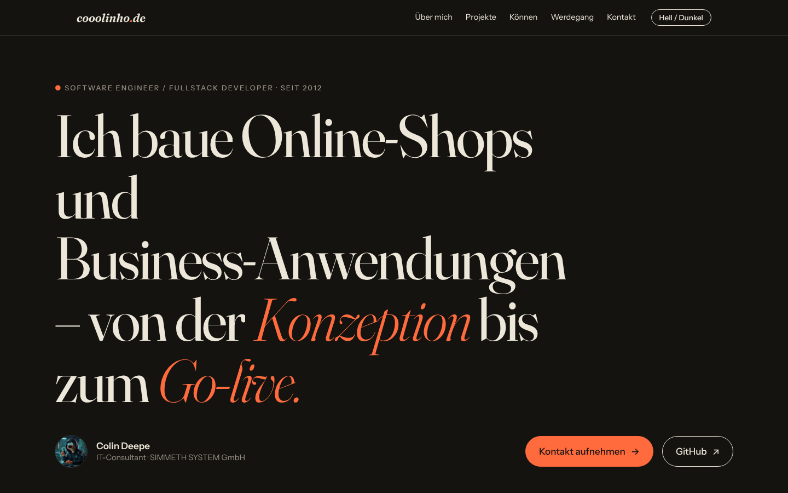 |

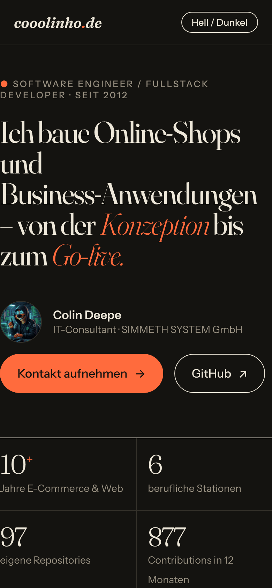

Ganze Seite: [Desktop hell](screenshots/b-editorial-desktop-hell.png) · [Desktop dunkel](screenshots/b-editorial-desktop-dunkel.png) · [Mobil](screenshots/b-editorial-mobil.png)

| | |
|---|---|
| **Terminal** | entfällt vollständig |
| **Aufbau** | Kopfzeile mit Navigation → große Aussage als Überschrift, darunter Avatar, Name und zwei Schaltflächen → vier Kennzahlen → Kapitel Nº 01–07: Über mich, Fokus, Projekte, Können, Werdegang (inkl. Ehrenamt), GitHub, Kontakt. Kapitelüberschrift bleibt links stehen, während der Inhalt rechts scrollt |
| **Farben hell** | Papier `#f6f1e7`, Text `#1b1a17`, Linien `#d6ccba`, Akzent Zinnoberrot `#cf3f17` |
| **Farben dunkel** | Hintergrund `#141310`, Text `#ede7d9`, Linien `#34312a`, Akzent `#ff6b3d` |
| **Schriften** | Fraunces (Serife, Überschriften und Zahlen) + Instrument Sans (Fließtext) |
| **Bewegung** | Überschrift baut sich Wort für Wort auf; Inhalte gleiten beim Scrollen ein; Fortschrittslinie am oberen Rand; Laufband mit Technologien; Zähler; Heatmap-Punkte „ploppen“ auf |
| **Interaktion** | Projektzeilen färben sich beim Überfahren vollflächig um, Titel und Pfeil bewegen sich; E-Mail-Adresse unterstreicht sich animiert |

**Stärken:** beste Lesbarkeit, wirkt seriös und hochwertig – die sicherste Wahl für Recruiter und Kunden. Die Kernaussage steht sofort im Raum, der Kontakt ist ohne Scrollen erreichbar.

**Schwächen:** der Bezug zur bisherigen Seite geht verloren, „Entwickler-Charakter“ entsteht nur über die Inhalte. Die längste der drei Seiten. Von den dreien am wenigsten verspielt.

---

### Entwurf C – „Bento“

**Idee:** Eine farbige Kachel-Oberfläche, in der jede Kachel eine Sache erzählt. Das Terminal lebt als einzelne Kachel weiter – als Zitat statt als Korsett.

| Hell | Dunkel |
|---|---|
| 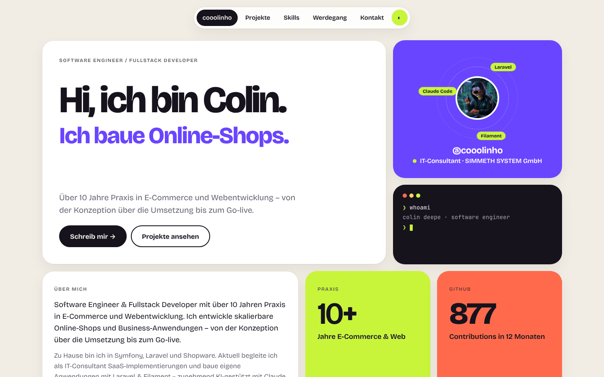 | 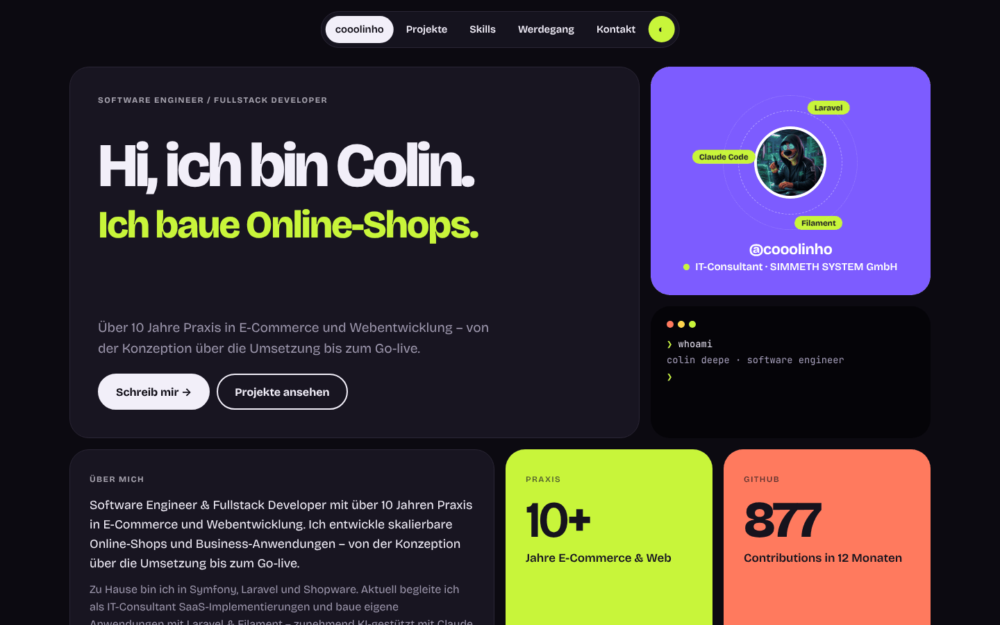 |

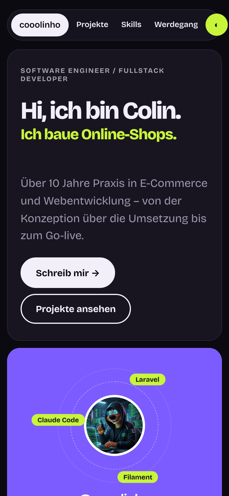

Ganze Seite: [Desktop hell](screenshots/c-bento-desktop-hell.png) · [Desktop dunkel](screenshots/c-bento-desktop-dunkel.png) · [Mobil](screenshots/c-bento-mobil.png)

| | |
|---|---|
| **Terminal** | nur als Akzent: eine dunkle Kachel, in der `whoami`, `cat focus.md` und `uptime` in Schleife getippt werden |
| **Aufbau** | schwebende Navigation → Kacheln: Begrüßung, Avatar, Terminal, Über mich, zwei Kennzahlen → Fokus (3 Kacheln) → Skill-Laufband → Projekte (6 Kacheln) → Skills mit Reitern → Werdegang zum Aufklappen neben GitHub und Ehrenamt → große Kontakt-Kachel |
| **Farben hell** | Hintergrund `#f1ede4`, Kachel `#ffffff`, Text `#16131d`, Violett `#6a45ff`, Limette `#c8f53a`, Koralle `#ff6a4d` |
| **Farben dunkel** | Hintergrund `#0c0a11`, Kachel `#181521`, Text `#f2eff9`, Violett `#7d5cff`, Limette `#c8f53a`, Koralle `#ff7a5e` |
| **Schriften** | Bricolage Grotesque (alles) + JetBrains Mono (nur Terminal-Kachel) |
| **Bewegung** | Kacheln springen gestaffelt ins Bild; wechselnde Zeile im Hero („Ich baue Online-Shops / Admin-Panels / …“); Fokus-Themen kreisen um den Avatar; zwei gegenläufige Skill-Laufbänder; Heatmap als Welle |
| **Interaktion** | Kacheln kippen zur Maus und bekommen einen Lichtfleck; Skill-Reiter; Werdegang als Akkordeon; „Adresse kopieren“ |

**Stärken:** am lebendigsten und zeitgemäßesten, erfüllt „ausgeprägte Animation“ am deutlichsten. Kürzeste Seite, weil Kacheln nebeneinander stehen; auf einen Blick erfassbar. Funktioniert für alle drei Zielgruppen, ohne den Entwickler-Bezug aufzugeben.

**Schwächen:** die kräftigen Farben sind Geschmackssache und weniger zurückhaltend als B. Der Werdegang ist eingeklappt – wer alle Stationen lesen will, muss klicken. Auf dem Handy werden die Kacheln zu einer langen Liste, der Raster-Effekt geht dort verloren.

---

## 4. Vergleich

| | A – Shell | B – Editorial | C – Bento |
|---|---|---|---|
| Terminal-Bezug | Leitmotiv | keiner | eine Kachel |
| Wirkung | technisch, eigen | ruhig, seriös | lebendig, modern |
| Entwickler-Community | ●●● | ●○○ | ●●○ |
| Recruiter | ●●○ | ●●● | ●●● |
| Kunden | ●○○ | ●●● | ●●○ |
| Lesbarkeit langer Texte | ●●○ | ●●● | ●●○ |
| Verspieltheit / Animation | ●●○ | ●●○ | ●●● |
| Seitenlänge Desktop (1440 px) | ca. 4.800 px | ca. 6.800 px | ca. 4.200 px |
| Nähe zur heutigen Seite | hoch | keine | gering |
| Umsetzungsaufwand | mittel | gering | mittel |

Die Punkte sind eine Einschätzung, keine Messung.

---

## 5. Empfehlung

**Entwurf C – „Bento“.** Er passt am besten zu den Vorgaben „Mischung aus allen Zielgruppen“ und „ausgeprägte Animation“: Recruiter und Kunden finden sofort Einstieg, Kennzahlen und Kontakt, Entwickler bekommen mit Terminal-Kachel, Heatmap und Projekten ihren Anknüpfungspunkt.

- Wem der Wiedererkennungswert der heutigen Seite am wichtigsten ist: **A**.
- Wem Seriosität und Lesbarkeit wichtiger sind als Verspieltheit: **B**.

Kombinationen sind möglich, zum Beispiel C mit der Befehlszeile aus A als verstecktem Extra oder B mit der Farbwelt von C.

---

## 6. Nächste Schritte

1. Entwurf auswählen, Änderungswünsche sammeln (Farben, Texte, Reihenfolge der Bereiche).
2. Umsetzung in `index.html`, `src/style.scss` und `src/main.js`. Dabei bleiben erhalten: SEO-Angaben und strukturierte Daten, das automatische Einlesen von `src/data/github-stats.json`, Build und Deployment.
3. ~~`theme-color`, `color-scheme` und das OG-Bild an das neue Design anpassen.~~ Erledigt – OG-Bild, Favicon und Apple-Touch-Icon im Bento-Stil, Vorlage in `scripts/og-image/`.
4. ~~Schriften lokal einbinden statt über Google Fonts laden.~~ Erledigt – `src/fonts/` und `src/_fonts.scss`.

**Hinweise zu den Mockups**

- Die Inhalte kommen aus [`mockups/shared/content.js`](mockups/shared/content.js), einer Momentaufnahme von `index.html` und den GitHub-Statistiken vom 16.09.2026. Neue Formulierungen (z. B. die Überschrift in B, die wechselnde Zeile in C) sind Vorschläge.
- `public/foto.png` ist ein illustrierter Avatar (1024 × 1024 px). In den strukturierten Daten der Live-Seite steht dafür noch 734 × 693 px – das sollte bei der Umsetzung korrigiert werden.
- Der Ordner `docs/` ist nicht Teil des Builds und wird nicht ausgeliefert.
